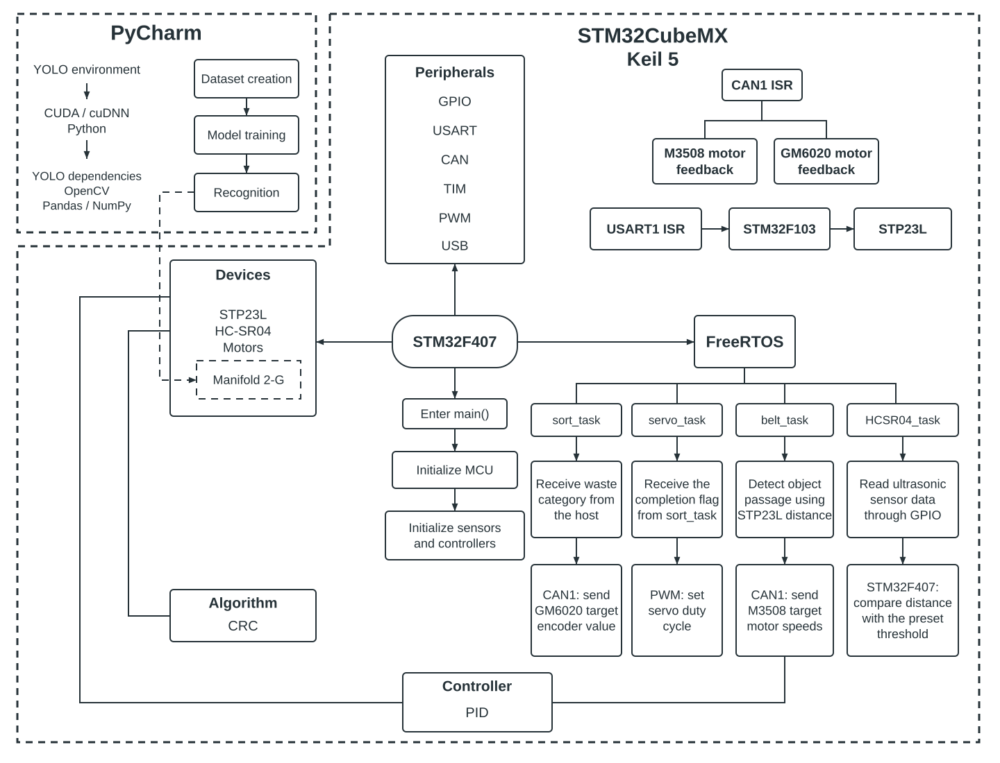

# Modular Vision-Based Waste-Sorting System — Embedded Controller

STM32 firmware for the embedded actuation and device-integration layer of a modular waste-sorting prototype. The controller interfaces with a host-side recognition system over USB and coordinates conveyor motors, a rotary sorting mechanism, a release servo, distance sensing, a serial display, and a compression actuator.

**Platform:** STM32F407 · FreeRTOS / CMSIS-RTOS · STM32 HAL · CAN · USB CDC · UART · PWM  
**Development log:** October 2024–February 2025, recorded in [main.c](Core/Src/main.c).

## System at a glance

| Subsystem | Embedded work represented in this repository |
| --- | --- |
| Host interface | USB reception of category commands and a separate framed PC communication module |
| Conveyors | Three motor-feedback channels, PID speed control, and distance-dependent transport sequencing |
| Rotary sorter | CAN motor feedback and cascaded position / speed control |
| Release mechanism | PWM servo sequence linked to category reception |
| Distance sensing | UART reception and numeric distance extraction |
| User interface | Serial-display page commands and category counters |
| Compression | Emm V5 position commands and actuator feedback handling |

The vision model, training pipeline, and host inference application are separate from this embedded repository. See [snapshot notes](docs/snapshot_notes.md) for the exact behavior of the archived configuration.

## Architecture

English rendering of the project design diagram. For the task configuration in the archived firmware, see the [hardware and task map](docs/hardware_and_tasks.md).

## Start reading

| Purpose | Source |
| --- | --- |
| Startup and original development log | [Core/Src/main.c](Core/Src/main.c) |
| Task configuration | [Core/Src/freertos.c](Core/Src/freertos.c) |
| Conveyor sequencing | [Application/belt_motor.c](Application/belt_motor.c) |
| Rotary sorter | [Application/sort_motor.c](Application/sort_motor.c) |
| Servo release | [Application/sort_servo.c](Application/sort_servo.c) |
| CAN feedback and commands | [Application/bsp_can.c](Application/bsp_can.c) |
| USB receive callback | [USB_DEVICE/App/usbd_cdc_if.c](USB_DEVICE/App/usbd_cdc_if.c) |
| Compression | [Application/compress.c](Application/compress.c) |

## Documentation

- [Development timeline](docs/development_timeline.md)
- [Hardware and task map](docs/hardware_and_tasks.md)
- [Build and reproduction](docs/build.md)
- [Communication and category mapping](docs/interfaces.md)
- [Archived configuration and engineering follow-up](docs/snapshot_notes.md)
- [Demonstration and contribution evidence](docs/portfolio_evidence.md)
- [Source attribution](THIRD_PARTY_NOTICES.md)
- [Original project document](readme.docx)

## Build

Open [MDK-ARM/Dustbin.uvprojx](MDK-ARM/Dustbin.uvprojx) in Keil µVision and select target **Dustbin**. The project records ARMCC **5.06 update 5 (build 528)** and device pack **Keil.STM32F4xx_DFP.1.0.8**. See [build notes](docs/build.md) before reproducing the hardware configuration.

This documentation update preserves the archived firmware. Its local project references were checked against the repository tree; a fresh compilation and hardware run are separate validation steps. No classification-accuracy or cycle-time benchmark is asserted here.

