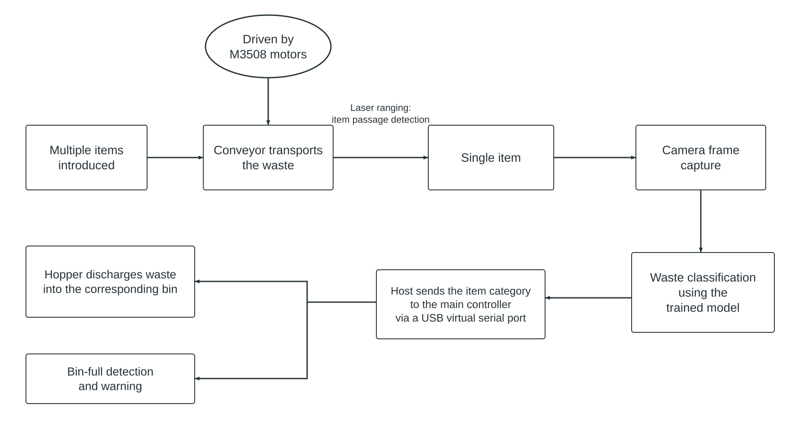

# Demonstration and Contribution Evidence

This repository is the embedded-controller part of the waste-sorting project. A strong demonstration can connect an incoming category command, the transport / sorting action, and the resulting physical placement.

## Sorting workflow

English rendering of the project workflow: item transport and detection, image-based classification, category transmission, and the discharge / bin-full detection branches.

## Evidence to attach

| Item | Useful content |
| --- | --- |
| Prototype photograph | Annotated conveyor, sorter, release, sensor and controller locations |
| Short video | Category input, physical sorting sequence, and display response |
| Tested configuration | Board revision, motor IDs, calibration, servo limits, sensor units and firmware commit |
| Measurement record | Trial conditions, sample count, successes / failures and measured cycle-time definition |
| Personal contribution | Modules implemented, existing libraries integrated, tuning / debugging work and tests personally performed |

## Video recordings

| Demonstration | Playback | Repository file |
| --- | --- | --- |
| System operation | [Watch video](https://jiraiyamr.github.io/assets/videos/waste-sorting/operation.mp4) | [MP4](../media/videos/operation.mp4) |
